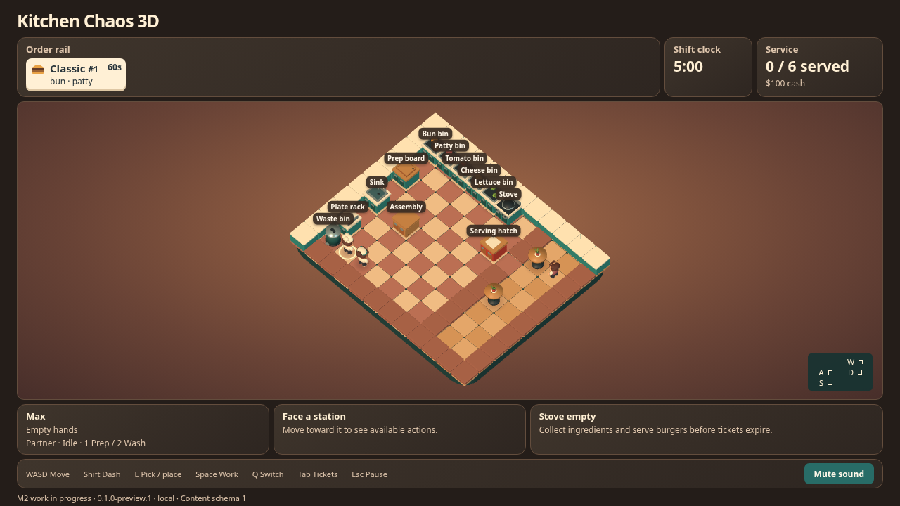
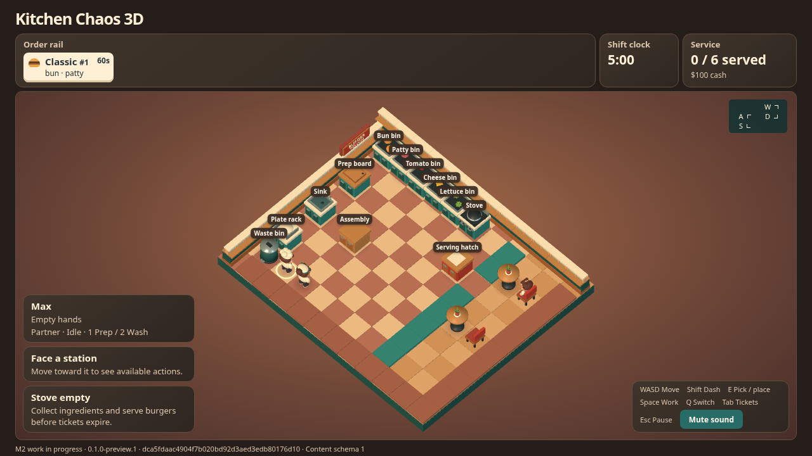
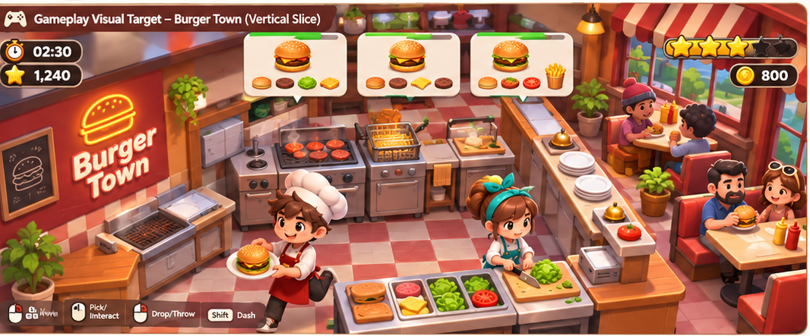
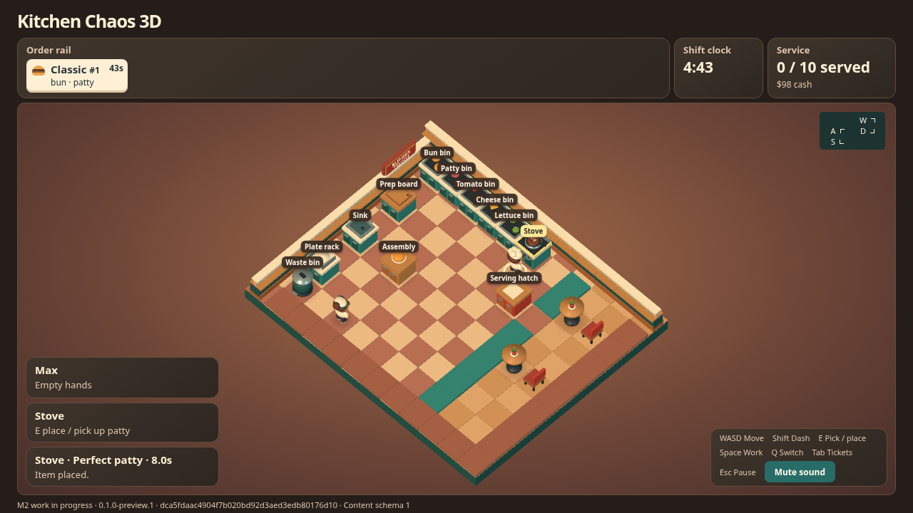

# M2 Burger Town screenshot review

Candidate code `dca5fda`, Chromium 156, Linux x86-64, SwiftShader. The screenshots were captured in the playable build. Quick shift starts at Day 3 seed 42. Career starts at Day 1 seed 42 and renders two physical seats. Captures use the 45° yaw and 55° elevation gameplay camera.

## Actual build

| Capture | 1280×720 | 1920×1080 |
|---|---|---|
| Boot | [PNG](1280x720/00-boot.png) | [PNG](1920x1080/00-boot.png) |
| Stove at 8 seconds | [PNG](1280x720/01-stove-ready.png) | [PNG](1920x1080/01-stove-ready.png) |
| Garden at hatch | [PNG](1280x720/02-garden-at-hatch.png) | [PNG](1920x1080/02-garden-at-hatch.png) |
| Three pending tickets | [PNG](1280x720/03-busy-order-rail.png) | [PNG](1920x1080/03-busy-order-rail.png) |
| Shift receipt | [PNG](1280x720/04-closed-shift.png) | [PNG](1920x1080/04-closed-shift.png) |
| Blocked placement | [PNG](1280x720/05-planning-blocked.png) | [PNG](1920x1080/05-planning-blocked.png) |
| Career customer seated | [PNG](1280x720/06-career-seated.png) | [PNG](1920x1080/06-career-seated.png) |
| Low graphics | [PNG](1280x720/07-low-graphics.png) | [PNG](1920x1080/07-low-graphics.png) |
| Career at 90 seconds | [PNG](1280x720/08-career-at-90s.png) | [PNG](1920x1080/08-career-at-90s.png) |

## Review against approved targets

| Target | Candidate observation | Score |
|---|---|---:|
| [Composition](../../../assets/concept/01_gameplay.png) | The HUD panels moved to the stage corners, enlarging the playable kitchen. Routes and the hatch remain visible. The reference fills more of the horizontal frame with kitchen and dining detail. | 3 |
| [Characters](../../../assets/concept/02_characters.png) | Distinct tall and short headwear read from overhead. Clothing, faces and hand contact need a closer gameplay-scale motion pass. Guest variants reuse one silhouette. | 2 |
| [Kitchen](../../../assets/concept/03_kitchen.png) | Warm checkerboard, glazed panels, wall modules, chairs, brass and steel details now reflect the palette. The screenshot still reads as a sparse miniature compared with the furnished reference. | 2 |
| [Food](../../../assets/concept/04_food.png) | Profiled bread, grill marks, curled lettuce and seeded tomato exist in GLBs. The cooked layers and fine state differences are small at the actual camera. | 2 |
| [HUD](../../../assets/concept/05_ui.png) | Cream ticket cards and clearly named inputs remain readable at both sizes. Tickets reuse a generic burger icon and the planning panel lacks the reference's icon and category treatment. | 2 |
| [Motion and audio](../../../docs/INTERACTIONS_AND_ANIMATION.md) | Imported clips and audio controls run. Full contact, timing, audible mix and player response require a live motion pass. | 2 |

[Before the HUD and wall iteration](1280-before-hud-and-wall-iteration.png) · [Combined approved board](../../../assets/concept/00_visual_board.png) · [GLB validation log](gltf-validation.jsonl)

## Visual comparison at gameplay scale

| Earlier M2 capture | Candidate capture |
|---|---|
|  |  |

| Approved composition | Candidate composition |
|---|---|
|  |  |
